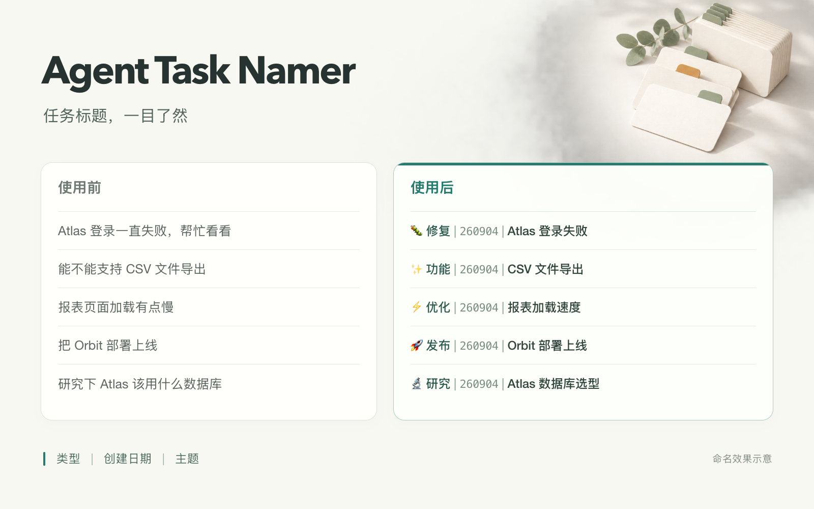

# Agent Task Namer

[English](README.md)

为 Codex 和 Claude 桌面端的本地 Code 会话自动添加类型、创建日期和主题，让侧栏里的任务更容易找到。



*命名效果示意：同一组任务，统一类型、创建日期与主题。*

标题跟随各任务主要提问的语言。日期使用任务创建当天，默认按北京时间计算，续聊不变。你明确指定的标题会保留。

## 在 Codex 中开始使用

适用于具备官方任务读取、改名工具的 **Codex 桌面端本地任务**。自动命名还需要 **Python 3**，并完成下方的一次性配置。

将这个公开 GitHub 仓库作为 Codex 仓库 Marketplace 添加并安装插件。在终端运行：

```sh
codex plugin marketplace add deronendless/agent-task-namer
codex plugin add agent-task-namer@agent-task-namer
```

重启 Codex，打开 **Plugins**，选择 **Agent Task Namer**，审阅内置启动 Hook 后点击 **Trust all**。

如果当前版本不支持仓库 Marketplace，也可以把下面这句话发给 Codex，安装独立 Skill：

```text
请从 https://github.com/deronendless/agent-task-namer/tree/v0.1.7/skills/agent-task-namer 安装 agent-task-namer 这个 Skill。
```

安装后，先试着给当前任务命名：

```text
$agent-task-namer 按规范重命名当前任务。
```

侧栏标题应变成上方示例中的格式。已经准确合规的标题会保留；缺少可靠创建时间时只生成类型和主题草稿，不猜日期。

## 让新任务自动命名

插件已经包含自动命名 Hook，完成信任后不需要单独配置。

如果安装的是独立 Skill，发送：

```text
$agent-task-namer 帮我启用新任务自动命名。
```

按客户端提示完成首次 Hook 信任，然后新建一个本地任务，像平常一样提问，例如“帮我修复登录报错”。首次实质请求明确后才会命名，打开空任务不会命名。续聊、恢复旧任务不会触发新的自动改名。

不要同时启用插件和独立 Skill 的命名 Hook，否则会产生重复提醒。切换安装方式时请查看[配置与迁移说明](skills/agent-task-namer/references/automatic.md)。

没有生效时，直接发送：

```text
$agent-task-namer 检查一下为什么没有自动命名。
```

[故障排查](skills/agent-task-namer/references/troubleshooting.md)列出了检查项和对应处理方式。

## 在 Claude Code 中开始使用

适用于 **Claude 桌面端 Code 标签页的本地会话**，它提供当前会话的原生工具。自动命名还需要 **Python 3**。同一个插件也能在终端 CLI 中加载，但 CLI 改名仍为实验性。

将这个公开 GitHub 仓库作为 Claude Code 插件 Marketplace 添加并安装插件。在 Claude Code 终端会话中运行：

```text
/plugin marketplace add deronendless/agent-task-namer
/plugin install agent-task-namer@agent-task-namer
```

详情页会列出插件包含的内容：一个 Skill 和一个 `SessionStart` Hook。审阅后选择安装范围。内置 Hook 不需要在 `settings.json` 里添加任何条目，从下一个新会话开始生效。终端和桌面端本地 Code 会话共用用户设置，在其中一处按用户范围安装后，另一处也能使用。

如果当前版本不支持仓库 Marketplace，可以改装独立 Skill：把 `skills/agent-task-namer/` 复制到 `~/.claude/skills/agent-task-namer/`，再让 `/agent-task-namer` 启用新会话自动命名。不要同时使用插件和独立 Skill 的命名 Hook，否则每个新会话会收到两次提醒；见[配置与迁移说明](skills/agent-task-namer/references/automatic.md#claude-code-plugin-installation)。

安装后，先试着给当前会话命名。插件内的 Skill 带有插件前缀：

```text
/agent-task-namer:agent-task-namer 按规范重命名当前会话。
```

侧栏标题应变成上方示例中的格式。新会话在首次实质请求明确后会自动命名。

## 更多用法

插件页面提供三个入口：**命名当前任务**、**预览项目标题**和**诊断自动命名**。预览不会执行改名。

- **预览或整理 Codex 任务：**让 `$agent-task-namer` “预览新标题，先不要执行改名”，或“整理当前项目的所有任务命名”。[批量改名与恢复](skills/agent-task-namer/references/batch.md)。
- **切换语言：**直接说“保留格式，把当前任务标题改成英文”。
- **Claude 桌面端的本地 Code 会话：**安装上面的插件或独立 Skill 后，直接要求改名或诊断。需要客户端提供当前会话原生工具；[桌面端配置](skills/agent-task-namer/references/automatic.md#desktop-code)无需 SDK。
- **Claude Code 本地 CLI（实验性）：**安装同一个插件或 Skill，并[配置可选 SDK](skills/agent-task-namer/references/automatic.md#claude-code-local-cli-setup)。CLI 完整流程仍待验证。Claude 暂不支持批量改名与恢复。
- **其他 Agent：**加载 [Skill](skills/agent-task-namer/SKILL.md) 后生成标题建议，不提供直接改名。

## 验证

在仓库根目录运行离线检查：

```sh
python3 -m unittest discover -s skills/agent-task-namer/scripts
python3 -m unittest discover -s hooks
python3 skills/agent-task-namer/scripts/eval_cases.py check
```

结构化案例覆盖命名条件、语言、日期和回读失败。Hook 测试还会检查两个插件包，包括 Claude Code 插件引用的每个路径。`check` 仅检查案例结构；独立盲测与真实客户端检查见[行为评测说明](skills/agent-task-namer/references/validation.md)。

---

[完整规则](skills/agent-task-namer/SKILL.md) · [MIT 许可证](LICENSE)

完整规则与参考文档使用英文。社区 Skill，非 OpenAI 或 Anthropic 官方产品。
